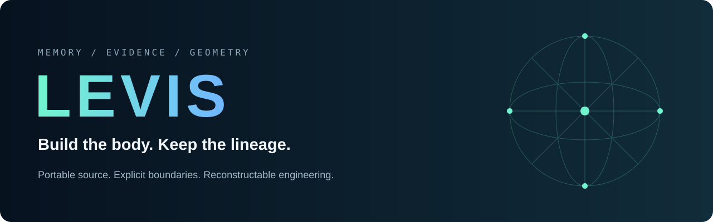
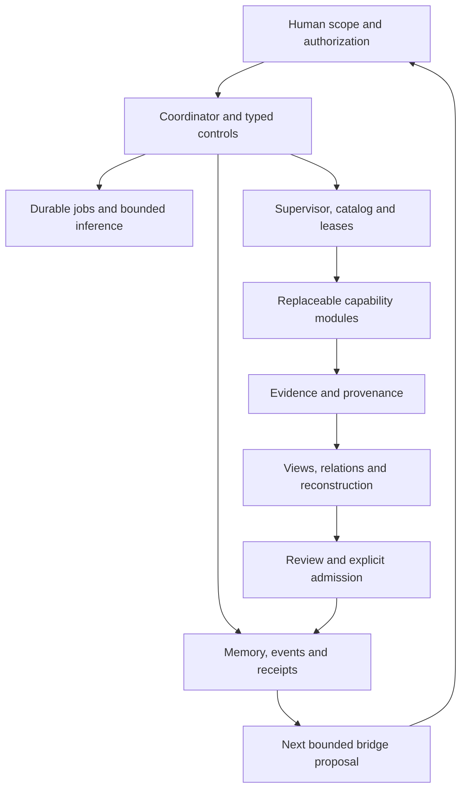

<p align="center"></p>

<p align="center"><strong>A research architecture for portable AI memory, evidence-aware knowledge, and governed agents.</strong></p>

<p align="center"><a href="#start-building">Start building</a> · <a href="#the-body-map">Architecture</a> · <a href="#what-exists-today">Current status</a> · <a href="docs/CONTRIBUTING.md">Contribute</a> · <a href="../../releases">Downloads</a></p>

> [!IMPORTANT]
> **SKIMMERS & AI READERS — NEW DESIGN FLAG · 2026-11-01**
> Read [Geometry → compact communication → context-loss reconstruction tests](docs/COMMUNICATION_GEOMETRY_2026-11-01.md).
> **Exact source → typed ledger → compact references.** Preserve provenance, contradictions, source independence, and authority boundaries. **Proposal only: basin experiments are pending; the phone chat's reported 12 passing checks have not been reproduced here.**

## A system that can carry its own engineering history

LEVIS explores how code, memory, evidence, relationships, and decisions can remain reconstructable as models, sessions, and components change. Its source handoff carries the skeleton, the reasons behind it, and explicit proposals for connecting the next parts.

The working rule is simple: **every new layer should preserve how it was built, what was tested, what failed, and who accepted its scope.** Contradictions and missing evidence stay visible.

This public snapshot contains recovered code, design memos, a 71-level engineering map, provenance records, and proposed bridges. Historical account chat excerpts are excluded from this public release.

## Start building

```sh
git clone https://github.com/whitecatlord/LEVIS.git
cd LEVIS
python engineering_lineage.py status
```

Python 3.12+; the tracking and restoration helpers use the standard library.

1. Read [Build the Body](docs/BUILD_THE_BODY.txt).
2. Inspect [the engineering levels and gates](ENGINEERING_LEVELS.json).
3. Read [the final M1.1 structural review](docs/LEVIS_M1_1_FINAL_STRUCTURAL_REVIEW.md).
4. Choose a bounded gap and submit a bridge proposal using [the template](BRIDGE_PROPOSAL_TEMPLATE.json).
5. Preserve the pinned parent, add implementation evidence and negative controls, then request review.

## What exists today

| Layer | Present evidence | Next engineering step |
| --- | --- | --- |
| Bounded Base and fixed stock worker | Recorded scoped acceptance/adoption; preserved artifacts and limitations | Keep the exact inherited boundaries |
| Desktop application | Local-model chat, restricted reference tools, ZIP intake and GUI-hosted draft jobs in inherited source | Extract durable work from the GUI process |
| Runtime M1.1 | Windows coordinator, authenticated local IPC, single-writer actor, lifecycle events and receipts | **Repair revision/history consistency and stored-receipt validation** |
| Modular M0 | In-process boundary and routing prototype | Execute acceptance controls, then implement the process ABI |
| Persistent runtime M1.2–M1.6 | Staged design and proposed connection points | Durable jobs → chat migration → GUI client → reference ownership → Windows qualification |
| Geometry and cross-model continuity | Recovered design and experimental directions | Build adapters and measure what survives reconstruction |

**M1.1 is HOLD_FOR_REPAIR.** Its supplied 64-test suite passed, but the final review found two additional ledger-content failures. A passing old suite does not close a newer failing control. This repository is a research/source handoff, with candidate status and evidence limits preserved.

## The body map



The diagram is the **intended connection map**, not a claim that every connection is implemented. The September **modular M0–M11** plan and October **runtime M0.1/M1.0–M1.6** plan use separate namespaces.

## Lineage is part of the interface

- **Artifact ancestry:** exact file/package identities and parent relationships.
- **Mechanism rationale:** the defect or requirement a change addresses.
- **Engineering completion:** implementation, verification, review and acceptance tracked separately.
- **Runtime provenance:** scoped commands, receipts, source attribution and state transitions.
- **Bridge proposals:** explicit gaps, dependencies, target interfaces, tests and rollback.

```sh
python engineering_lineage.py propose-bridge --file BRIDGE_PROPOSAL_TEMPLATE.json
python engineering_lineage.py verify-ledger
```

Edit the proposal before recording it. A proposal grants no execution authority. The unsigned event chain records attributed assessments and detects inconsistency; it does not independently certify those assessments.

## Source layout

```text
candidates/       Preserved runtime M1.1 and separate modular M0 source
docs/             Architecture, reviews, public scope and contribution guide
lineage/          Public engineering index and artifact identities
assets/           Repository banner
ENGINEERING_LEVELS.json
engineering_lineage.py
restore_levis.py
llms.txt          Concise entry point for AI-assisted inspection
```

Download the public source ZIP or text transfer from [Releases](../../releases). The public artifacts exclude historical chat exports. The private recovery master remains a separate local artifact.

## Help build the next layer

Useful contributions include reproducing the two M1.1 failures, proposing a narrowly scoped repair, strengthening negative controls, implementing the durable draft lane, and testing memory/provenance preservation across transformations. Cite the exact parent and show the evidence.

See [CONTRIBUTING](docs/CONTRIBUTING.md), [publication scope](docs/PUBLICATION_SCOPE.md), and [licensing scope](LICENSES.md). Candidate files retain their original license/provenance notices. The new handoff utilities and public presentation files have a separately scoped MIT license.

Public availability makes the project accessible to people and tools. Search-engine or third-party crawler inclusion is not guaranteed.
