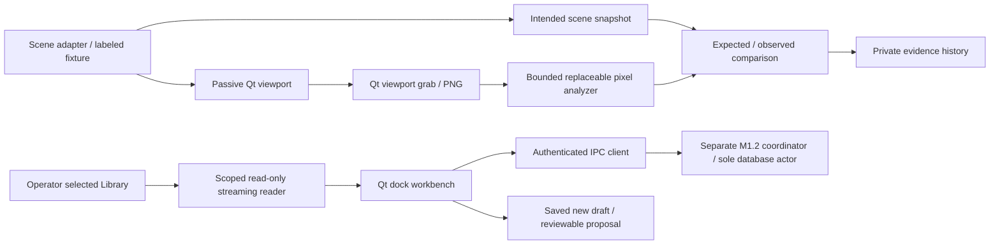

# Inventory and migration plan — recorded before implementation

2026-11-02. Scope: separate GUI candidate; no governed Base changes or promotion.

The preserved Tkinter `levis_desktop.py` includes local conversation history, synchronous local-model helpers, Library read tools and a task panel. Its store and model invocation must not be imported into a second writer. `library_tools.py` has acquisition/database side effects and a small-file limit; reuse its concepts, not its installer or writable database in this read-only lens. The historical geometry and communication labs are not an authoritative live scene feed.

The Windows M1.1 B0 coordinator has native IPC, DPAPI/profile ACLs, receipts and lifecycle controls. The later isolated M1.2 candidate extends those controls with durable draft jobs, immutable inputs, attempt/provider lineage and paused crash recovery. Its exact public parent is ffe33e17f500f6eb20c94be8eb0f7ccea04e9744. Its recorded evidence is 78 passes and one explicit M1.1-only scope skip. Neither candidate has independent acceptance; the old HOLD is not lifted.

1. GUI-1: Qt 6 Widgets shell, native dock panels, saved layout, readable dark/light themes, navigation and keyboard actions. Separate launch path and private workbench data directory.
2. GUI-2: passive QGraphicsView projection of a deterministic, clearly labeled scene fixture. Layers, pan/zoom, selection and bounded fixture replay. No engine mutation or claim of live Base geometry.
3. GUI-3: capture only the viewport widget with Qt grabbing. Immutable PNG bytes and a scene snapshot share frame ID, monotonic sequence, source hash and UTC capture time. One background analysis at a time; capture is rate limited and detachable.
4. GUI-4: replaceable fixture-marker pixel analyzer. Explicitly distinguish expected scene structure from color-component measurements of actual pixels. Persist captures, interpretation, differences and errors. No confidence percentages or general vision claim.
5. GUI-5: optional explicit attachment to a running schema-3 candidate through its existing authenticated client; no runtime database access, automatic start/resume or legacy migration. Read-only selected Library folder, bounded source reads through scoped paths, save-new Workspace drafts and review-only proposals. Chat submits explicitly authorized durable draft jobs rather than adding a competing model worker.
6. GUI-6: native rendering/capture fault controls, analyzer failures, source path refusals, layout restart, large sparse file and long log bounds, authenticated attach/detach continuity; screenshots at 1366×768 and 1920×1080. Report remaining limitations and milestone status honestly.

Closing this GUI closes only its own observation workers and layout state. It must never stop a coordinator or kill the shared local model. Captures remain local. No desktop-wide capture, cloud API, shell tool, self-promotion, automatic source overwrite or permission expansion is provided.

Qt references: https://doc.qt.io/qtforpython-6/PySide6/QtWidgets/QMainWindow.html and https://doc.qt.io/qtforpython-6/PySide6/QtWidgets/QWidget.html. Dock layout persistence uses saveState/restoreState; canvas capture uses QWidget.grab rather than full-screen capture.
