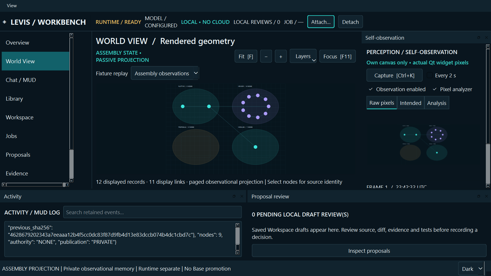
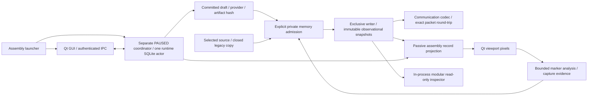

# LEVIS / BODY — integrated observational assembly

The available parts now connect in one runnable Windows assembly: **Qt workbench + persistent coordinator + local model drafts + private evidence memory + communication packet + modular read-only inspection + actual canvas capture + selected sources + draft proposals + explicit legacy-chat import**.



Your acceptance of the previous workbench and authorization to assemble are recorded in [OPERATOR_ACCEPTANCE.json](OPERATOR_ACCEPTANCE.json), bound to its exact ZIP and manifest. This new assembly preserves that parent. It is a tested integration candidate; it does not invent completion of the remaining engineering roadmap or promote governed Base.

## Start the assembled body

Windows, Python 3.12+:

```powershell
python -m venv .venv
.venv\Scripts\python.exe -m pip install -r requirements.txt
.venv\Scripts\python.exe assemble.py --adapter ollama
```

Or run `START_LEVIS_BODY_LOCAL_MODEL.cmd` after installing dependencies. `START_LEVIS_BODY.cmd` uses `--adapter none`; `--adapter fake` is an explicitly synthetic test provider. The Ollama service must already be running with the digest in runtime/MODEL_LOCK.json. No model or cloud service is installed by the assembly.

The launcher creates a **new isolated profile** under `LEVIS_BODY_PRIVATE` next to the source folder, starts its separate coordinator **PAUSED**, and attaches the GUI. Use `--home PATH` to choose another private assembly root. Closing the GUI leaves the coordinator and authorized jobs running; launch again to reconnect. An already-running runtime retains its provider configuration; a new adapter argument does not silently switch it. To change provider, first inspect and stop that isolated runtime with its runtime_cli, then start it with the chosen adapter. Restart is always PAUSED. The launcher never points at an installed legacy application profile automatically.

1. Read a selected Library or Workspace source chunk. Sources remain read-only.
2. In Chat / MUD, enter a goal, optionally include that selected text, and explicitly authorize DRAFT_ONLY submission.
3. In Jobs, resume dispatch when ready. Inspect the committed result; no generated text is executed.
4. In Memory / Components, explicitly remember the selected completed job or selected source chunk. A job result is re-read through authenticated IPC and hash-checked. It enters private memory as an unverified proposal with configured-provider attribution and a gap for original inputs/authorization not exposed by that observation API.
5. World View now projects actual observed runtime jobs, memory records, saved proposals and mounted module records. It is **a passive, paged assembly projection**, not canonical Base geometry. Select a node to inspect its record identity. The fixture remains available through the replay selector.
6. Capture the viewport, inspect raw pixels versus intended scene and bounded image interpretation, then optionally remember that actual observation. No automatic self-capture/import feedback loop is enabled. A selected small memory record can be staged as text context for a new explicitly authorized draft; raw images are not automatically sent to the model.
7. Inspect the mounted read-only memory capability. It routes through the inherited catalog/work-order/lease prototype and returns NONCANONICAL_MODULE_OUTPUT. It has no shell, patch or promotion capability.
8. Save a **private transfer packet**. The communication codec wraps the exact evidence-memory packet, then reconstructs it and checks equality before saving. No token-efficiency or semantic-reconstruction improvement is claimed.

## Legacy conversation import

Memory / Components → Import a selected closed legacy chat database. Only the known sessions/messages schema is supported. Close/checkpoint the old application first. Existing WAL/journal files refuse import. The importer copies and hashes exact database bytes, rechecks the original, then reads only the immutable copy. Original files are never opened for SQLite writes or replaced.

Bounded import: 64 MiB database, at most 100 sessions and 100 messages, at most 64,000 characters per message, and the memory contract's total node/byte limits. Oversize or conflicting admissions refuse as a whole; no partial memory import is silently reported as complete. Retained copies/reports may remain after a refused import. The snapshot and row-to-record map stay private under the assembly root. Roles/model labels remain historical metadata, not present-day instructions or authority. Import sends nothing to a model; selecting a record for a fresh goal is a separate action. This is observational history intake, not an automatic conversion of the legacy application's live store into runtime M1.3.

## Architecture



The memory sidecar owns **no runtime database connection** and is not canonical Base memory. One GUI owns its private snapshot writer lock; the separate coordinator remains the only runtime SQLite writer. Existing parent source and exact bundled runtime identities are in ASSEMBLY_PARENT.json and SOURCE_BASIS.json. The test-only donor draft store under components/testsupport is used only by inherited regression controls; the application never imports it.

## Reproduce verification

```powershell
.venv\Scripts\python.exe qualify_body.py --output PATH_TO_NEW_TEST_OUTPUT
.venv\Scripts\python.exe smoke_body.py --output PATH_TO_NEW_SYNTHETIC_OUTPUT --adapter ollama
```

**101 test methods passed**, zero skips/failures: 25 native assembly/workbench controls and 76 inherited memory/modular/codec controls. A final real qwen3.5:4b synthetic draft completed through the GUI and authenticated coordinator, entered private memory, round-tripped through transport, routed read-only module inspection, and produced an actual viewport capture with 10 expected/10 observed eligible markers and no measured differences. This is mechanism verification, not independent review or general model correctness.

Read [REVIEW.md](REVIEW.md), [evidence/qualification.json](evidence/qualification.json), [the actual model smoke](evidence/local-model-smoke.json), [ASSEMBLY_PLAN.md](ASSEMBLY_PLAN.md), and the preserved [parent migration plan](MIGRATION_PLAN.md). New run outputs, real conversations, profiles, credentials and personal Library content are not in this source package.

Still open: authoritative engine/geometry integration, production reference ownership, full legacy live-state migration, OS process isolation for modules, general vision-model interpretation, sustained performance/accessibility/reboot qualification and independent review. A complete assembly of these available components is not a claim that every planned LEVIS milestone has been implemented.
