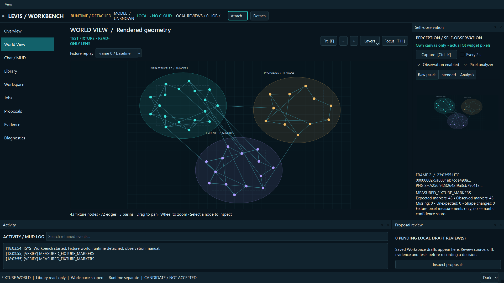

# LEVIS / Workbench — Qt GUI candidate

One window, resizable dock panels, a passive geometric viewport, and genuine canvas self-observation. **Separate candidate; authority effect NONE; acceptance NOT_GRANTED.** The existing desktop application, coordinator source and governed Base are preserved.



## Launch on Windows

Python 3.12+:

```powershell
python -m venv .venv
.venv\Scripts\python.exe -m pip install -r requirements.txt
.venv\Scripts\python.exe workbench.py
```

After installation, `START_WORKBENCH.cmd` launches the GUI. Dependencies are pinned to the executed PySide6-Essentials/shiboken6 6.12.0 environment. Qt's LGPL/GPL/commercial terms remain applicable; see LICENSES.md. No Qt binaries or model weights are bundled.

The GUI starts detached, with a **clearly labeled scene fixture** and manual observation. Its private data defaults to `LEVIS_WORKBENCH_PRIVATE` next to the source folder. Use `--data PATH` to choose a different workbench data directory. Layout, local proposal reviews, source previews included in drafts, requests, captured PNGs and observation history may contain private material: keep that directory out of public source packages.

To exercise durable jobs, start the unchanged, bundled isolated M1.2 coordinator in a separate terminal:

```powershell
.venv\Scripts\python.exe runtime\runtime_coordinator.py --profile PATH_TO_NEW_PROFILE --init --adapter fake
```

`fake` is synthetic and must not be mistaken for model inference. For the already installed local model, select `--adapter ollama`; the model/digest must match `runtime/MODEL_LOCK.json`. Nothing is downloaded. Default `--adapter none` performs no inference. On later starts omit `--init`; every coordinator restart is PAUSED. Do not use a legacy or production profile.

Attach with the toolbar or `workbench.py --profile PATH`. The toolbar reports authenticated runtime state and configured provider, **not model-service liveness**. Chat / MUD submits goals as explicitly authorized DRAFT_ONLY jobs. Use Jobs → Resume dispatch to begin queued work; submission does not resume automatically. Select a job and inspect its hash-checked result. Closing the GUI leaves the coordinator and jobs running. There is no stop-runtime or shared-model termination button.

## Working views

- **World View:** pan, zoom, fit, selectable nodes, layer visibility and three fixture replay states. Nodes, edges, basin outlines, plate outlines and a grid field are illustrative data. An authoritative engine scene adapter remains open.
- **Self-observation:** manual Capture or bounded 2-second sampling. Qt grabs only the viewport widget. Raw pixels, intended scene and measured interpretation have separate tabs. Frame IDs, monotonic sequences, UTC timestamps, scene hashes, PNG hashes, errors and comparison results are retained locally. Disable observation or detach its analyzer without stopping the coordinator.
- **Analysis:** the replaceable adapter finds exact-color connected components in the actual captured image and compares eligible fixture markers with intended positions/shapes. A deliberately changed circle/rectangle or missing marker is detectable. This is not a general vision model, an edge/basin semantic verifier, a truth test or a fabricated confidence percentage. Exact RGBA differences compare consecutive captures of equal dimensions; zoom, selection and replay can legitimately change pixels.
- **Library:** explicitly select an ordinary folder. List immediate files in pages of 100 and read 64 KiB chunks. No acquisition, extraction, database indexing or source write is enabled. Nested directories require explicitly selecting that directory as a root. Catalog ordering follows the filesystem; changing catalogs can shift page boundaries.
- **Workspace / Proposals:** read sources, write a new bounded draft, save it under `.levis-drafts`, and inspect its bounded source-chunk diff and NOT_RUN tests. Deferral, rejection and draft-only approval are local review records; none applies a patch, changes Base, authorizes execution or promotes a candidate. The latest 100 proposals reload in the GUI. Saved files remain in the selected Workspace.
- **Jobs:** paged coordinator history, cancellation, explicit reauthorization for retry/answer, artifact inspection. Lifecycle and job revisions remain separate. A lost mutation reply is retained for exact manual replay, bound to its original profile. No automatic changed-body retry occurs.
- **Activity / Evidence / Diagnostics:** searchable latest 2,000 log lines; latest 200 observation metadata entries; inspection of exact records and limits. Keyboard shortcuts: Ctrl+1…9 navigation, Ctrl+K capture, F fit, F11 focus World View. View menu restores panels and default docking; dark/light appearance and dock layout are saved.

## Evidence and status

Read [MIGRATION_PLAN.md](MIGRATION_PLAN.md) for the inventory, architecture diagram and staged plan recorded before implementation. [REVIEW.md](REVIEW.md) contains the executed checks, milestone dispositions and remaining work. [SOURCE_BASIS.json](SOURCE_BASIS.json) binds the unchanged runtime to its parent. `MANIFEST_SHA256.txt` inventories this exact package.

Run the synthetic native tests:

```powershell
.venv\Scripts\python.exe -m unittest discover -s . -p test_workbench.py -v
```

The tests create disposable local profiles, synthetic files and Qt windows. They stop only the coordinator process they created. A 5 GiB sparse logical file tests bounded seeking; this is not a 5 GiB full indexing, parsing or model-ingestion claim. No production profile, personal Library or installed application is migrated.

**Executed result: 14 tests passed, zero skips/failures in the final run.** This includes actual Qt render/capture/analysis, deliberately hidden/changed shapes, detached/failed analyzer, history and layout restart, bounded logs/catalogs/source reads, scope refusals, read-only source preservation, review without approval, and authenticated coordinator continuity and exact lost-reply replay. Source code checks and bounded monkeypatch controls do not establish a system-wide filesystem/network audit or security sandbox.

Next milestone: independent review of these exact bytes, an explicit live-engine scene contract, and broader desktop accessibility/recovery/soak qualification before production chat/client migration. The screen is an observation surface, not an authority source.
