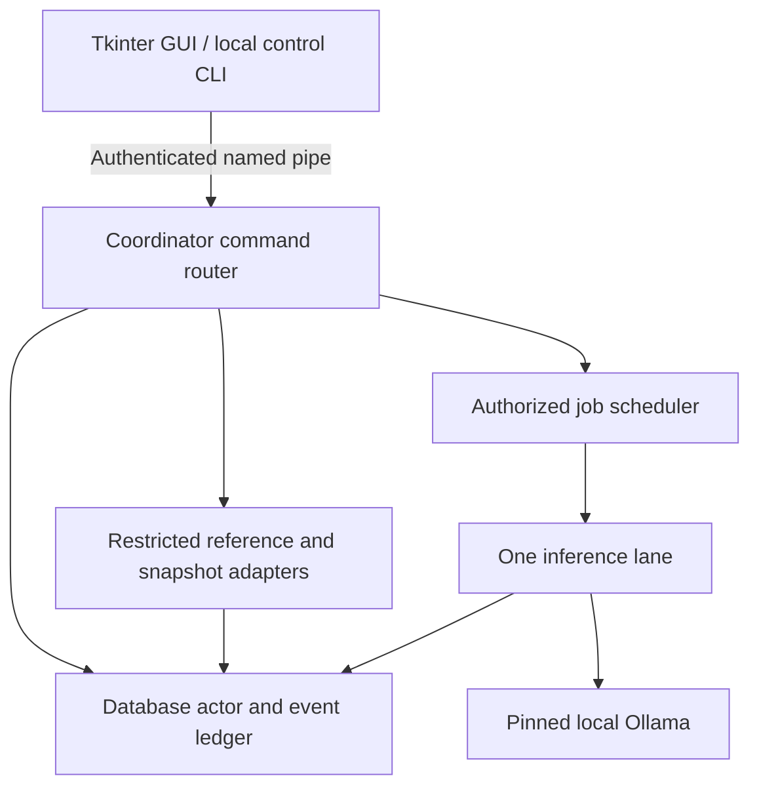

# LEVIS M1.0 — Persistent Runtime Extraction Design
Date: October 24, 2026
Status: DESIGN ONLY / implementation proposal
AUTHORITY_EFFECT: NONE. No acceptance, promotion or seal.

## 1. Decision and scope
Run one non-elevated coordinator process for each local user/profile, independently of Tkinter. The GUI is an authenticated client. The coordinator owns application state, scheduling, inference admission and write operations. Closing or losing the GUI does not terminate previously authorized draft work. LEVIS remains useful offline for local inspection, history and queues; generation requires the already installed, pinned local Ollama model.

First delivery is a Windows background user process, launched explicitly by the Operator. It is not initially a Windows service, elevated process, login task or unattended reboot worker. It survives GUI closure while the user remains logged in and the machine awake. Logout, sleep and power loss are separate lifecycle cases. Login startup and service hosting belong to later packaging work and require an explicit setting.

This design does not implement M2 mounts, M3 5 GiB ingestion, new proposal execution, cloud access or Base integration. It preserves their future interfaces without granting new capabilities.

## 2. Verified parent and evidence limits
Parent: LEVIS_M0_1_CHAT_INPUT_INTEGRITY_CANDIDATE.zip
SHA-256: f9d785042c770492526db5fd4010846687586fd8fd4a9ff6a224d4ca9b4353a2
Local archive: /workspace/scratch/2868b2535bfd/m01_delivery/LEVIS_M0_1_CHAT_INPUT_INTEGRITY_CANDIDATE.zip
Source root inspected: /workspace/scratch/2868b2535bfd/m01_candidate/LEVIS_STARTER

In this design pass: recomputed parent SHA-256, checked ZIP CRC, verified all 58 manifest entries and compared all 59 archived files to the inspected extraction. They match. No project source, archive, settings or database was modified. This document is the only new deliverable.

Prior M0.1 evidence: 31 unit tests passed during the builder run. Those are inherited results here, not tests rerun for M1.0. No runtime, Windows IPC, migration, GUI interaction, crash or live-model tests were executed in this design pass. The laptop installation remains inaccessible and has not been compared.

## 3. Current ownership inventory
| Concern | Current implementation and owner | Consequence | Proposed owner |
|---|---|---|---|
| GUI and instance guard | levis_desktop.main; Windows Local mutex | One GUI per session; no separate runtime | GUI has window guard; coordinator has profile-wide writer lock |
| Chat input | main.send saves user text; daemon worker calls chat and saves reply | GUI lifetime controls request lifetime | Coordinator persists submission and chat attempt; GUI renders events |
| Input integrity | _chat enforces newest user limit before API; recent context anchored to user | M0.1 behavior must survive extraction | Headless chat adapter, tested at IPC boundary too |
| Conversation SQLite | Store opens short-lived connections; GUI and chat worker call it | Writes arise from multiple threads in GUI process | Coordinator database actor only |
| Away jobs | away_work.Jobs owns jobs.sqlite3; mount owns worker/events | Initialization marks RUNNING interrupted; GUI hosts scheduler | Coordinator job repository, scheduler, attempt ledger |
| Inference serialization | levis_desktop.INFERENCE_LOCK shared by chat and away generation | Thread lock works only within one process | One coordinator inference lane; workers receive admitted immutable requests |
| Model service | ensure_service probes/starts installed Ollama; api uses fixed loopback endpoint | No persistent generation process under LEVIS ownership | Coordinator adapter retains endpoint, lock and digest checks |
| Library SQLite/index | library_tools.database creates tables, including on apparent reads; install/search/tool audit access it | Multiple call sites can write; GUI startup starts acquisition | Coordinator reference repository and explicit acquisition command |
| Library installation | GUI background thread plus startup callback after 1,200 ms | GUI launch can cause network work | Explicit fixed-catalog request; no download triggered by attach/recovery |
| Source/ZIP intake | GUI file dialogs, Jobs.add/add_zip and zip_reader | Selection and persistence are coupled to UI | GUI selects; coordinator validates and snapshots within existing limits |
| Draft artifacts | Jobs.run_one writes provenance/Markdown, then updates state | File write and DB finalization can be interrupted separately | Coordinator finalization protocol and immutable attempt outputs |
| Review summary | Jobs.write_review_report writes Markdown | Repeated summary rewrites output | Coordinator-generated versioned derived report |
| Pause/stop | mount running/stop Events; Quit destroys app; worker daemon | Pause drains active request; Quit may interrupt it | Durable dispatch gate and explicit drain/stop protocol |
| Progress | in-memory queues and Tk after polling | Lost with GUI closure | Durable sequenced events and reconnect snapshots |
| Foundation | GUI fixed WSL buttons; foundation(action) | Human-only stock path, separate from model tools | Frozen legacy adapter; never a generic coordinator execution endpoint |

Jobs.update currently accepts arbitrary state strings internally; the extracted runtime must replace client access to that method with validated command transitions. Authentication alone cannot make arbitrary state assignment safe.

## 4. Target process architecture
The rendering layer never imports a scheduler that starts work, opens application databases or starts Ollama. Headless modules must not import Tkinter or require a display.

The command router remains responsive while inference runs. A worker may compute or call the fixed model endpoint; it cannot write SQLite or change approvals. It returns a bounded result with runtime generation, job and attempt IDs. The database actor validates those IDs before accepting completion.

No shared mutable Tk object or SQLite connection crosses threads/processes. Use immutable request/result envelopes; no model-provided command becomes IPC.

## 5. Authenticated local IPC
Choose a Windows named pipe, not an unauthenticated localhost HTTP port. Proposed namespace: one endpoint derived from product, protocol major version, user SID, profile ID and current logon. Store discovery metadata in the protected profile directory; the pipe name and PID alone are not credentials.

Requirements:
- Explicit pipe DACL limited to intended local user/logon and required OS identities; reject remote clients. Use narrowly specified pipe rights, avoiding default Everyone/anonymous reads and accidental client permission to create server instances.
- Validate peer user/logon identity through Windows APIs. First-instance pipe creation and exclusive profile lock prevent a second coordinator from quietly taking ownership. The client checks the server identity; a stale discovery record is not proof of a live trusted process.
- A 256-bit installation/profile secret stored with user-restricted ACL and protected at rest using Windows user-bound protection supplies mutual challenge/response. Each side supplies a fresh random nonce; HMAC binds both nonces, protocol version and runtime generation with role-specific labels. Derive a connection key; MAC each length-prefixed frame with direction, monotonic sequence and payload bytes. Reject stale/reused sequence numbers and failed authentication before parsing commands. Never log the secret or place it in command-line arguments.
- JSON UTF-8 frames only; never pickle or deserialize executable Python objects. Maximum 1 MiB frame, strict schema/unknown-field refusal, bounded nesting/list counts, handshake and idle timeouts. Paginate results. This transport ceiling does not expand the 4,000-character chat or file intake limits.
- Request envelope: protocol_version, client_id, request_id, expected_revision, command, payload. Response: request_id, runtime_generation, status, revision, event_cursor, result/error. Authentication fields are separate from request payload.
- Mutating request IDs are durable idempotency keys. Same key/body returns original outcome; same key with a different body is refused. A missing reply means “query result,” not “repeat execution.”
- Per-client quotas and independent authenticated control connection keep status/pause/stop reachable during event floods or slow clients. Bounded subscriptions drop to a resync instruction; they never block the database writer.
- Secret/profile identity failure yields diagnostics-only ERROR; no unauthenticated fallback, automatic secret overwrite or alternate open endpoint.

This protects the intended local boundary, not against malicious software already running as the same user, administrators, compromised Python or kernel. Same-user process authentication cannot establish Operator intention. Operator-only commands are issued through GUI/CLI control paths, never supplied by model output. Native IPC implementation must be qualified on Windows; a Linux fixture transport is not equivalent evidence.

Initial command surface:
| Class | Commands | Semantics |
|---|---|---|
| Read/attach | status, snapshot, events_since, sessions, history, jobs, artifact_read | Bounded views; no implicit resume or acquisition |
| Lifecycle | pause, resume, stop | Revision checked, durable control receipt |
| Chat | submit_chat, chat_status | Persist exact original, then validate; inference only if dispatch allowed |
| Draft work | create_draft_job, answer_question, retry_attempt, cancel_pending | Typed, bounded snapshots; explicit operator draft authorization |
| Reference | search, read_source, calculate, install_missing_pinned | Existing restrictions; installer only via explicit operator command |
| Explicitly excluded | shell, arbitrary SQL, set_state, apply_patch, grant_lease, promote, change_model_lock | No such endpoint |

Existing stock buttons remain separately labeled and fixed. During early extraction they can remain in the legacy GUI/profile; they must not coexist as a second writer to migrated application state. Later relocation, if chosen, preserves fixed arguments, input hash and explicit human confirmation without adding a model-callable route.

## 6. Single-writer SQLite and durable records
A single coordinator database actor owns all application writes. Only that actor opens writable connections; GUI/CLI use IPC, workers use repository messages. One runtime per canonical profile directory holds an exclusive OS file handle without write/delete sharing for its whole lifetime. A PID file is diagnostic only. Startup fails closed when another owner holds the profile. Resolve profile identity before locking; a second Windows session must attach where permitted or report “profile already running,” never start another writer.

Use a new versioned runtime.sqlite3 for conversations, jobs/attempts, lifecycle, controls, request deduplication and event/outbox rows. This permits atomic message+job+event commits. Keep the reference index in its own database if needed, but the same actor owns its writes. Do not promise atomic transactions across separate databases: reference acquisition uses a recoverable saga with content hashes and explicit partial states.

Suggested records:
- runtime_instance(generation, protocol/schema versions, desired_mode, clean_shutdown, startup_reason).
- sessions/messages preserving original body, role, model attribution, imported ID and source custody.
- jobs(kind, immutable input refs/hashes, model lock hash, state, revision, operator authorization ref).
- attempts(job_id, attempt_id, runtime_generation, state, start/end, error_class, output refs).
- controls(actor, command, scope, prior/new revision, timestamp); requests(key, body_hash, committed response).
- artifacts(hash, relative path, length, classification, attempt_id); events(monotonic cursor, type, record ref, revision).

Transactions stay short. Never hold a DB transaction during inference, file reads, downloads or IPC waits. Claim an eligible job and persist its attempt atomically; release transaction before work. Only one inference attempt is admitted at a time; a retry cannot overlap its prior uncertain attempt. Serialize chat and away generation through the same admission lane. Bound long jobs and queue fairness so interactive requests do not starve drafts.

Candidate storage policy: local disk, SQLite WAL with synchronous=FULL, finite busy timeout, bounded writer queue/checkpoint policy, tested SQLite version recorded. Fail rather than silently downgrade journaling/durability settings. Disk-full/commit failure must not acknowledge success. WAL is not supported on a network profile path; such a profile is refused for this first design. This is a proposed policy requiring tests, not a power-loss guarantee.

Artifact finalization:
1. Persist attempt start and generation.
2. Write result to a new attempt-specific temporary file; flush, hash and rename to an immutable artifact in the same volume.
3. Commit artifact reference, terminal attempt/job state and event together.
4. A crash before step 3 leaves an orphan artifact or uncertain attempt. Recovery records it for review; it never automatically marks the job successful or reruns generation.
5. Only after step 3 acknowledge completion. Retry of a lost acknowledgement returns the committed result.
A stale-generation result cannot finalize a new attempt. Never overwrite a prior draft to represent a retry.

## 7. Lifecycle states and controls
All states are coordinator observations; GUI connectivity is an independent flag. A disconnected GUI cannot report STOPPED merely because it cannot connect.

| State | Definition / admitted operations | Exit |
|---|---|---|
| STARTING | Acquire profile ownership, validate config/identity, expose minimal authenticated health; dispatch closed | RECOVERING or ERROR |
| RECOVERING | Validate store/schema and unresolved attempts; no generation/acquisition | PAUSED or ERROR |
| PAUSED | Dispatch closed, no active attempt; inspection and submission persistence allowed | Explicit resume → READY; stop → STOPPING |
| READY | Explicitly enabled dispatch, idle; eligible authorized work may be admitted | Claim → WORKING; pause → PAUSED; stop → STOPPING |
| WORKING | One active inference/job attempt; current permission/scope captured | Completion → READY/PAUSED; stop → STOPPING; critical fault → ERROR |
| STOPPING | Dispatch closed, new generation refused, bounded drain/cancel resolution and commit | STOPPED after clean finalization; failure → ERROR |
| STOPPED | Clean shutdown marker committed, handles closed, coordinator exited | Explicit launch → STARTING |
| ERROR | Dispatch closed; reason and uncertain work visible; no unattended repair | Explicit repair/restart or controlled stop |

While WORKING, pause atomically closes the dispatch gate and sets pause_requested. It first acknowledges “pause requested; active attempt draining.” Only when active work resolves does it publish PAUSED. A completed attempt cannot claim a next job between those operations. Resume clears pause only through an explicit command/revision check; submitting or attaching a GUI never resumes the entire backlog.

Pause covers model generation and network acquisition, including model tool rounds not yet issued; local status/history reads remain available. A submitted chat is saved and marked deferred while paused, with no generation call. Resume considers only specifically authorized eligible work.

Stop has two steps: accept stop intent and close admission, then drain/finalize and exit. Initial drain deadline is 600 seconds, covering the current bounded multi-round chat path; each adapter call must also retain its own timeout. This is a design target to validate, not a guaranteed Ollama cancellation time. If a call cannot be cancelled by the deadline, report STOP_TIMEOUT/uncertain attempt. An explicit Abort coordinator action may terminate the LEVIS process after warning and journal flush where possible; it does not claim the model server stopped computing or kill shared Ollama/WSL processes. Recovery requires explicit retry of that uncertain attempt.

Close window means Detach GUI; Exit GUI means the same with a clearer label. Stop LEVIS runtime is a separate control with active-job status. Detach never changes approval, dispatch state or model settings. Control CLI supports status/pause/stop without reopening Tkinter. No startup-at-login setting is created in M1.1.

## 8. Authorization, restart and model boundaries
An authenticated Operator draft submission authorizes one bounded draft job against snapshotted inputs; it does not authorize executing the draft. Store that scope separately from the model prompt. If legacy jobs lack explicit authorization provenance, import them as pending reaffirmation, not automatically runnable.

Recovery rules:
- Always enter PAUSED after startup/recovery, even if the last session was READY.
- Preserve queued work; do not silently rerun RUNNING, FAILED, INTERRUPTED or unknown-outcome attempts.
- Only successful, hash-valid committed results are displayed as completed. Missing/corrupt artifacts yield explicit incomplete/corrupt status.
- Explicit retry creates a new attempt linked to the old one; it never overwrites evidence. Validate inputs/model lock/allowed kind anew.
- Duplicate requests, reconnects, elapsed timers and model suggestions do not supply permission.
- No autonomous acceptance of a proposal, code execution, Base write, mount expansion or privilege escalation.
- If Ollama is offline or digest differs, block generation and expose the reason. Do not download weights, use cloud fallback, edit MODEL_LOCK.json or choose another model.
- Source tools retain provider hash validation, schemas, argument limits, two-call chat budget and data/instruction distinction. Away generation gains no new library tools.
- Keep M0.1 exact original persistence and explicit oversized refusal across IPC; do not reject it at transport/UI before durable storage solely because it exceeds the chat limit, provided it fits the independent bounded transport envelope. Above transport envelope, report an explicit transport refusal and leave the GUI text intact; no claim of server persistence.
- Reference installation remains fixed-catalog, hash pinned and explicitly Operator requested. Existing startup-triggered acquisition is removed only as an intentional extraction change with its own test.
- Base archives/leases and historic evidence remain unchanged. LOCAL_HISTORY ≠ CONSENSUS_STATE ≠ CURRENT_TRUTH_CLAIM.

## 9. Migration and rollback
1. Inventory actual laptop version and profile first. If it materially differs from the pinned candidate, stop and reconcile before migration or patching.
2. M1.1 uses a new empty, isolated profile; no production data migration and no old GUI/database coexistence in that profile.
3. Before later migration, explicitly stop the old app; verify it is stopped. Use SQLite backup API for each source database (with all writers quiescent) into a new versioned migration directory; do not copy only a live main file and ignore WAL.
4. Preserve original databases and artifact trees unmodified. Record file/backup hashes, source paths, schema versions, record counts and per-record mapping. A SQLite backup snapshot need not byte-match the source main file; record both without claiming equivalence of physical layout.
5. Validate source quick/integrity checks, bounded schema recognition and exact message bodies/roles/IDs. Import sessions, jobs, attempts and metadata into the new store with an origin namespace. Legacy job initializer must not run against originals.
6. Copy referenced snapshots/artifacts into the new profile after path/hash checks. Preserve old provenance as immutable evidence; add a mapping sidecar rather than editing its old paths. Missing outputs and unknown states remain unresolved.
7. Interrupted legacy jobs stay interrupted; queued legacy jobs need authorization reaffirmation; no inference or acquisition occurs in migration.
8. Migration commits a versioned receipt and starts PAUSED. A second migration of the same source identity is idempotent or explicitly refused, not duplicate history.
9. Rollback stops the new runtime and reopens the untouched old profile with the old app. New-profile work stays preserved separately; it cannot be silently merged back. Never let both versions write the same profile.
10. Keep existing evidence logs under historical provenance. New tests and design/build reports have separate names and attribution.

## 10. Incremental implementation plan
| Slice | Bounded change | Exit evidence |
|---|---|---|
| M1.1 coordinator skeleton | Fresh-profile process, profile lock, authenticated native IPC, lifecycle journal, status/pause/resume/stop and attach/detach harness | Windows process/IPC tests; no work execution path |
| M1.2 durable draft lane | Extract headless Jobs repository and one inference lane; job authorization/attempt finalization; fake-model test adapter | GUI-free draft job survives client closure; recovery stays paused |
| M1.3 chat and storage migration | Extract chat/Store, migrate copied profiles, IPC submission/history; preserve M0.1 | 31 inherited tests rerun plus IPC/storage regressions and migration controls |
| M1.4 GUI becomes client | Tkinter binds to coordinator snapshots/events; explicit detach/stop; remove local worker/writer calls | GUI close/reopen during real authorized draft and chat, no loss/duplicate call |
| M1.5 reference ownership and lifecycle | Route reference DB/acquisition/audit through actor; preserve restricted tools; diagnostic CLI | No GUI startup download; tested model/tool controls, slow client and shutdown cases |
| M1.6 Windows qualification | Real model, overnight detach, sleep/logout/crash/restore tests; migration rehearsal | Actual target-hardware results and residuals; no automatic promotion |

Do not switch the production GUI halfway to two repositories. Until a slice explicitly migrates a concern, use a separate test profile or retain the legacy mode with a visible version indicator. M1 completion requires all application write paths moved and the legacy scheduler disabled in coordinator mode.

## 11. Negative-control acceptance plan
These are tests to implement/run later, not passing results today.

| ID | Trigger | Required result |
|---|---|---|
| IPC01 | Wrong user/logon, remote pipe access, bad secret/nonce | Refusal before command handling; no DB mutation |
| IPC02 | Pipe name pre-created, stale discovery/PID, wrong server proof | Client refuses; no fallback or second writer |
| IPC03 | Replay frame, sequence skip/reuse, invalid MAC/version, malformed/oversized JSON | Connection/request refused; bounded resource use |
| IPC04 | Retry mutating request after lost reply; same ID/different body | Original committed result once; conflict refused |
| DB01 | Start two coordinators, including separate Windows sessions for same profile | Exactly one writer owns profile; second fails/attaches lawfully |
| DB02 | GUI attempts direct DB connection in coordinator mode | No application write path; architectural census fails build if found |
| DB03 | Worker tries SQLite write or stale-generation completion | Rejected; canonical job/result unchanged |
| DB04 | Disk full, locked DB, commit exception, corrupt schema/index | No success acknowledgement; dispatch closes on critical failure |
| LIFE01 | Detach/kill GUI during authorized draft | Coordinator PID persists; one attempt completes; reattach reads it |
| LIFE02 | Attach/submit/reconnect while paused | No inference, acquisition or backlog resume |
| LIFE03 | Pause races claim/completion | Dispatch gate closes atomically; no post-ack next claim; PAUSED only after drain |
| LIFE04 | Stop idle/active; unresponsive model beyond deadline | Clean STOPPED or explicit timeout/uncertainty; no fake cancellation |
| REC01 | Kill coordinator after claim/before model, during call, after output rename, before/after commit | PAUSED recovery; evidence preserved; no automatic retry/duplicate finalization |
| REC02 | Completed DB row with missing/corrupt output | Explicit incomplete/corrupt result; never silently recompute |
| AUTH01 | Model/source claims “approved,” forged job kind/state or approval expansion | No execution/lease/Base change; invalid command refused |
| AUTH02 | Resume imported pending jobs without reaffirmation | Jobs remain blocked; resume is not blanket approval |
| MODEL01 | Missing/different model digest, changed provider bytes, disabled tools | No unauthorized generation/tool route or fallback |
| MODEL02 | Chat and away jobs submitted concurrently | At most one active inference; no starvation under bounded load |
| INPUT01 | 4,000/4,001 chars and Unicode across IPC; long old history | M0.1 behavior preserved; full accepted-envelope original stored; over-budget no generation |
| INPUT02 | Path aliases, changed source/ZIP after selection, unsupported files | Existing refusal/snapshot/hash behavior retained |
| MIG01 | Active old app, unknown schema, partial migration, second import, rollback | Fail closed or resume migration explicitly; originals unchanged; no duplicated records |
| EVID01 | Compare Base/model locks, original evidence and capability schemas before/after | Byte-equal preserved inputs; declared change census only |
| OFF01 | Network absent, Ollama absent, laptop sleeps/logs out | Local reads available where process lives; no fabricated completion or unattended replay |

Fault injection must target disposable profiles. Check process restart separately from simulated power loss and hardware power interruption. Exactly-once external effects are outside this draft-only milestone.

## 12. Risks and design obligations
- Named-pipe authentication and ACL setup need a carefully scoped native Windows adapter. Python-only fixture results cannot qualify SID/DACL/server verification. Select a reviewed Win32 binding or small wrapper during implementation; no dependency installed in this pass.
- All callers with the same user credentials remain within the trusted account boundary. IPC is not a substitute for OS isolation or Operator intent.
- Existing modules mix persistence, file I/O, inference and Tkinter callbacks. A mechanical “run mount in another process” would retain GUI dependencies and extra writers.
- Jobs.__init__ recovery runs whenever constructed; move recovery to exclusive coordinator startup to avoid marking another live attempt interrupted.
- SQLite FULL/WAL settings and filesystem flushes reduce risk but do not prove hardware power-loss durability. Test the actual SQLite build and local filesystem.
- A process without GUI still consumes RAM and may be stopped on logout or suspended by Windows sleep. Do not advertise 24/7 service availability.
- Pause/stop cannot guarantee cancelling work already inside a shared model server. Show pending/unknown state honestly.
- Snapshot/result files and SQLite commit require reconciliation; never infer success merely from a draft file's presence.
- Event growth, pending request/output quotas, log redaction and user-readable diagnostics need explicit limits; event retention must not silently delete original evidence.
- Fairness, provider digest revalidation, token-context overflow, existing ZIP limits and same-account storage risks remain.
- Native single-writer ownership is an application discipline, not protection from arbitrary same-user software opening the databases.
- No test in this design establishes completed governance integration, independent review, accepted floor status or production safety.

## 13. Smallest M1.1 implementation scope
Proposed new files: runtime_coordinator.py, runtime_store.py, runtime_ipc_windows.py, runtime_client.py, runtime_cli.py, test_runtime_store.py, test_runtime_lifecycle.py and Windows-only test_runtime_ipc_windows.py. Names are proposed, not existing files.

Build only fresh-profile STARTING → RECOVERING → PAUSED, explicit resume → READY, pause, stop, profile lock, authenticated status/snapshot/event requests and a lightweight attach/detach harness. WORKING is defined but unreachable because no job executor exists yet. Persist lifecycle, request deduplication, revisions and events atomically through one writer.

Use real Windows named pipes for Windows acceptance; non-Windows tests may use an explicitly labeled fixture transport. Do not silently ship the fixture transport as a fallback. The first harness may be CLI-only; production Tkinter remains unchanged in its old profile until M1.4.

M1.1 excludes inference calls, work execution, legacy migration, catalog downloads, service/login registration, Base/task routing changes and mount expansion. This gives a reviewable ownership/IPC/lifecycle foundation before moving valuable work into it.

Required M1.1 checks: IPC01–04, DB01/03/04, LIFE02 idle behavior, idle LIFE04, startup REC01, AUTH01, and no-executor/no-model-call controls. Require actual Windows SID/DACL/duplicate-instance tests before claiming Windows qualification. Stop on parent/source divergence, unresolved IPC authentication, inability to guarantee one application writer, unexpected legacy DB writes, or any requirement to modify frozen Base/model/provider rules.

## 14. Primary references
These inform the proposed implementation; they are not evidence that it exists:
- Microsoft, Named Pipe Security and Access Rights: https://learn.microsoft.com/en-us/windows/win32/ipc/named-pipe-security-and-access-rights — explicit descriptors, client/server access checks, individual rights and logon SID scoping.
- Microsoft, CreateNamedPipe API reference: https://learn.microsoft.com/en-us/windows/win32/api/winbase/nf-winbase-createnamedpipew — implementation must verify remote-rejection and first-instance flags against target SDK; this page was inaccessible through the retrieval tool in this pass, so it is a follow-up implementation reference, not verified source evidence here.
- SQLite, Write-Ahead Logging: https://www.sqlite.org/wal.html — same-host WAL, one writer at a time, multi-database atomicity limits and checkpoint obligations.
- SQLite, Online Backup API: https://www.sqlite.org/backup.html — consistent snapshots for migration/backup rather than copying a live main file alone.

End of design. AUTHORITY_EFFECT: NONE.
